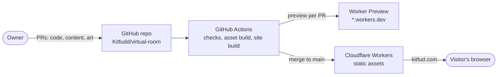
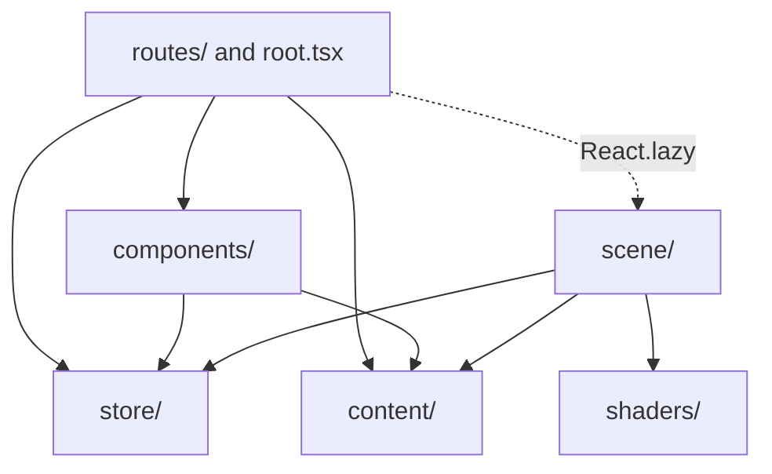
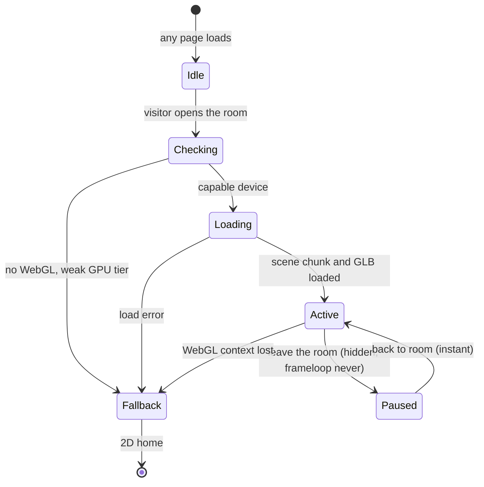
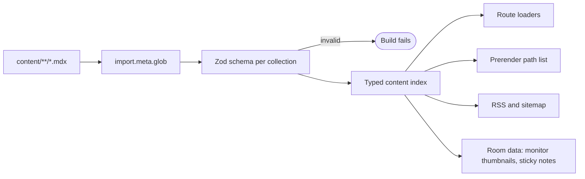
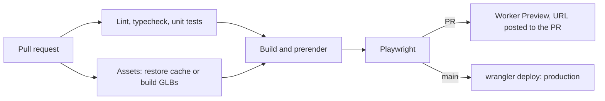

# Architecture

This document describes how the site is built and how its parts fit together. Some of the decisions and assumptions for the project architecture have been preserved through the [ADRs](adr/README.md). Additionally, the stack, pipeline stages, and roadmap have been logged in the [development plan](plan/development-plan.md) document.

## System context



The website is a fully static application with no server code, database, or third-party API dependencies at runtime. All pages, content, data, and assets delivered to visitors are generated during the CI build process from version-controlled source code and repository content ([ADR 0001](adr/0001-react-router-framework-mode.md), [ADR 0007](adr/0007-cloudflare-workers-hosting.md)).

## Repository layout

```
app/
  root.tsx           Root layout: 2D nav, skip link, theme, lazy room canvas
  routes.ts          Route table
  routes/            One module per route (loader, meta, component)
  components/        Shared 2D UI
  content/           Content loader and Zod schemas
  store/             Zustand stores
  scene/             R3F canvas, room, interactables, camera rig, the cat
  shaders/           GLSL (later TSL) materials and effects
content/             MDX by collection: projects/, devlog/, photos/, lab/, log/, pages/
art/                 Blender and texture sources (Git LFS); art/reference/ is private and ignored
tools/               Blender export script, gltf-transform and validator scripts
public/              Static files copied as-is; public/models/ is generated, never committed
docs/                Product, UX, art and planning docs, ADRs
```

## Module boundaries

Each folder under `app/` has one job, and imports flow downward only:



- Only `scene/` and `shaders/` import `three` or `@react-three/*` to keep three.js out of every content page's bundle (under 120 KB of JS) and to keep renderer code in one place for the WebGPU port ([ADR 0004](adr/0004-webgl-first-webgpu-later.md)).
- `scene/` and `shaders/` are only reached through `React.lazy`.
- `content/`, `store/` and `shaders/` import nothing else from `app/` so that they can remain independently testable.
- ESLint enforces the first rule with `no-restricted-imports` (will be set up in the lint tooling issue).

## Routes

| Route | Module | Data | 3D |
| --- | --- | --- | --- |
| `/` | `routes/home.tsx` | Latest items across collections ("what's new") | The room from v1.0 with the 2D site as its fallback until then |
| `/room` | `routes/room.tsx` | — | The room (preview route until v1.0) |
| `/projects`, `/projects/:slug` | `routes/projects*.tsx` | `projects` | — |
| `/resume` | `routes/resume.tsx` | `pages` | — |
| `/devlog`, `/devlog/:slug` | `routes/devlog*.tsx` | `devlog`, plus RSS at build | — |
| `/photos`, `/photos/:album` | `routes/photos*.tsx` | `photos` | — |
| `/about` | `routes/about.tsx` | `pages` | — |
| `/lab`, `/lab/:slug` | `routes/lab*.tsx` | `lab` | Per-demo canvas, lazy-loaded on the demo page only |
| `/log` | `routes/log.tsx` | `log` | — |
| `*` | `routes/not-found.tsx` | — | — (prerendered as the 404 page) |

## Room canvas at runtime

The canvas lives in the root layout so it survives navigation:



- An error boundary wraps the canvas that falls back to the 2D home in case of an error, and it never breaks a content page.
- While a camera move or animation runs, the canvas renders every frame. Otherwise, it renders on demand.
- Every interactable has a matching hidden DOM button, kept in sync with the scene, for keyboard and screen-reader users.

## State

The application will utilize two Zustand stores split by who needs them ([ADR 0005](adr/0005-zustand-and-gsap.md)):

```ts
type Theme = 'light' | 'dark'
type Weather = 'clear' | 'cloudy' | 'rain' | 'snow'
type QualityTier = 'low' | 'medium' | 'high'
type InteractableId = string // the INT_<section>_<object> name from the GLB

// store/site.ts: used on every page, never imports scene code
interface SiteState {
  theme: Theme            // system setting by default; the light switch and the 2D toggle change it (R14, S5)
  reducedMotion: boolean  // mirrors prefers-reduced-motion
  setTheme(theme: Theme): void
}

// store/room.ts: used by the room UI and the scene
interface RoomState {
  status: 'idle' | 'checking' | 'loading' | 'active' | 'paused' | 'fallback'
  quality: QualityTier                // set once from the GPU tier check (R12)
  hovered: InteractableId | null
  selected: InteractableId | null
  cameraTarget: 'home' | InteractableId
  lampOn: boolean                     // R16
  weather: Weather                    // R18–R20
  hover(id: InteractableId | null): void
  select(id: InteractableId): void
  returnHome(): void
}
```

## Content pipeline



Collections and fields are in the [content model](product/content-model.md), and the approach is [ADR 0006](adr/0006-mdx-content-with-zod.md).

## Asset pipeline

The stages (greybox to validation) are in the [development plan](plan/development-plan.md#art-and-asset-pipeline). Architecturally,

- Sources are `.blend` and texture files under `art/`, in Git LFS.
- One command, `npm run assets`, builds the models by running Blender headless with the export script in `tools/`, gltf-transform, and the budget validator, before finally writing GLBs to `public/models/`. Locally, it finds Blender through a `BLENDER_PATH` environment variable.
- GLBs are never committed - CI builds them, so what ships always matches the sources.
- **CI keeps LFS and Blender costs down with caching:**
  - Built GLBs are cached under a key hashed from `art/`, `tools/` and the lockfile. When nothing in those changed, CI restores the cache and skips Blender and LFS entirely.
  - Only on a cache miss does CI check out LFS files (restoring them from their own cache where possible) and install the pinned Blender version.
  - Other jobs never check out LFS files.

## Build and deployment



- All checks are required by the `main` ruleset, so production is only ever reached through a green pipeline ([ADR 0007](adr/0007-cloudflare-workers-hosting.md)).
- Preview builds add a `noindex` robots tag so public preview URLs stay out of search results.
- Secrets (`CLOUDFLARE_API_TOKEN`, `CLOUDFLARE_ACCOUNT_ID`) are only available to workflows from this repository, not to forks.
