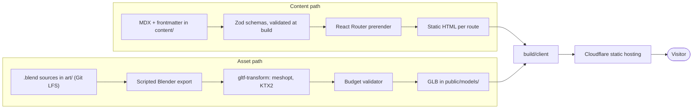
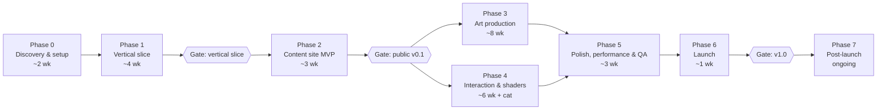

# Development plan

**Last revised:** 2026-11-27 (living document).

## Tech stack and architecture

The site is a React app built with Vite, using React Router in framework mode to prerender every content route to static HTML. The room is a React Three Fiber canvas that loads only when someone visits it.

The room canvas links to the content pages but does not contain them, so the site still works when the 3D layer is skipped.

| Layer | Choice | Why | How it's used here |
| --- | --- | --- | --- |
| Frontend framework | React 19 | React Three Fiber is a React renderer, so the 2D UI and the 3D scene share one component model | Pages, layout, HTML overlays |
| Navigation | [React Router v8](https://remix.run/blog/react-router-v8), framework mode, `ssr: false` + `prerender` | Real URLs, route-level code splitting, and [prerendering](https://reactrouter.com/how-to/pre-rendering) of each content route to static HTML for search engines and link previews | `routes.ts`, route `loader`/`meta` exports, `navigate()` after camera moves |
| Build tool | [Vite 8](https://vite.dev/blog/announcing-vite8) | Fast dev server and hot reload for shader tweaking, and the React Router framework runs as a Vite plugin | GLSL imported as strings (`?raw` or vite-plugin-glsl), MDX through @mdx-js/rollup, images through vite-imagetools |
| Language | TypeScript | Typed scene config, content schemas and store | Everywhere |
| 3D library | three.js (pinned) via React Three Fiber v9 and drei | Industry standard web stack, R3F v9 supports React 19 | Scene, raycasting, loaders, helpers |
| Renderer, phases 1-6 | `WebGLRenderer` + GLSL `ShaderMaterial` | GLSL maps closely to the HLSL used in Unity and Unreal, and most shader tutorials are written in it | Shader track #1-10 |
| Renderer, phase 7 | `WebGPURenderer` + TSL | three.js r182 made it the [recommended renderer](https://www.youngju.dev/blog/culture/2026-05-14-3d-development-for-web-three-js-react-three-fiber-webgpu-gaussian-splatting-deep-dive-2026.en), with automatic WebGL 2 fallback | Shader track #11-12 |
| State | Zustand | Lets the DOM UI and the canvas share state without re-rendering the scene each frame | Hovered/selected object, camera target, quality tier, light/dark mode, weather |
| Animation | GSAP | Precise easing and timelines | Camera moves, object animations, UI transitions |
| 3D modelling | [Blender 5.2 LTS](https://www.blender.org/releases/5-2/) | It's free and LTS gets fixes until July 2028 | Modelling, UVs, rigging, baking, scripted export |
| Asset format | glTF 2.0 / GLB, processed with gltf-transform (meshopt, KTX2) | The web's standard runtime format | Generated into `public/models/` by the pipeline |
| Debug and profiling | leva, drei's `StatsGl`, a dev-only `renderer.info` readout, Spector.js, browser GPU tools | Live-tweak shader uniforms; count draw calls and memory | Dev-only panels |
| Testing | Vitest, Playwright | Visual regression on the canvas | CI |
| Package manager | npm | One less tool to install and keep in sync, as it comes automatically with Node | `package-lock.json` committed; `npm ci` in CI |
| Hosting | Cloudflare Workers static assets ([ADR 0007](../adr/0007-cloudflare-workers-hosting.md)) | Free static hosting on a global CDN with a preview per PR; the domain and email are already on Cloudflare | Serves the prerendered `build/client` folder |

React Router v8 requires Node 22.22+, React 19.2.7+ and Vite 7 or newer ([release notes](https://remix.run/blog/react-router-v8)); the pinned versions satisfy all three.

### Architecture

Module boundaries, routes, the room canvas at runtime, state, as well as the content, asset and deployment pipelines, are described in [Architecture](../architecture.md).

## Art and asset pipeline

The pipeline runs one way from Blender to the browser and is scripted from the start.

### Pipeline stages

1. **Reference:** the room is measured and photographed from the chosen isometric angle; a moodboard of stylized rooms is collected in PureRef. Both stay private in `art/reference/`.
2. **Greybox:** walls and furniture blocked out at real-world scale (1 unit = 1 m) with simple primitives. The camera is locked in first.
3. **Camera:** an orthographic camera, rotated 45 degree around the vertical axis and about 35 degrees down, close to true isometric. The same values are used in Blender and three.js, so bakes and runtime line up. Framing is detailed in [Room and interactables](../art/room-and-interactables.md#camera-framing).
4. **Modelling:** final meshes, with bevels kept for silhouette edges only. Faces the camera can never see are deleted; the cutaway room draws two walls.
5. **UVs:** one consistent texel density, trim sheets for repeated surfaces, and a separate non-overlapping UV channel for lightmaps.
6. **Texturing and materials:** a small palette with hand-painted textures for the stylized look (see [Art direction](../art/art-direction.md)), kept to a few atlases so draw calls stay low.
7. **Lighting and baking:** lighting in Cycles, baked into lightmap atlases as separate layers (daylight, night ambience, ceiling light, desk lamp) that a shader mixes at runtime.
8. **Interactable tagging:** each clickable mesh is named `INT_<section>_<object>` (for example `INT_projects_monitor`), with metadata stored in Blender custom properties, which export as glTF `extras`.
9. **Export:** glTF/GLB through a scripted export (Blender Python), so settings never drift.
10. **Optimization:** gltf-transform dedupes, welds, meshopt-compresses geometry, resizes and converts textures to KTX2, then prints a size report.
11. **Validation:** a script checks names, triangle count, texture sizes and file size against the budgets, and fails CI on a violation.

### Conventions and budgets

Naming, units, UVs, texture sizes, bakes, rigging, asset budgets and the export checklist are in the [asset guidelines](../art/asset-guidelines.md).

## Rendering and shader track

There are twelve effects, where each adds a single new concept and fills a real need in the room. Every effect is built first in an isolated sandbox scene, with uniforms exposed in leva, before it goes into the room.

| # | Effect in the room | Concept it teaches | Phase |
| --- | --- | --- | --- |
| 1 | Unlit material showing the baked lightmap, remapped through the soft band ramp | Vertex/fragment basics, UVs, sampling, colour space (sRGB vs linear) | 1 |
| 2 | Hover highlight (fresnel rim + pulse) | Normals, view vectors, uniforms, time | 1 |
| 3 | Ink outline pass, tinted per material (the core of the look) | Screen-space edge detection vs inverted-hull outlines; trade-offs | 1 |
| 4 | Monitor screen with scrolling content | Texture animation, UV scrolling, emissive, scanline/CRT post effect | 4 |
| 5 | Window sky with drifting clouds | Gradients, value/fBm noise, remapping, layering | 4 |
| 6 | Plant and curtain sway | Vertex displacement, vertex-colour masks, wind functions | 4 |
| 7 | Mug steam | Scrolling noise, alpha blending, sorting, soft fade | 4 |
| 8 | Light/dark mode with the timelapse | Blending lightmap layers, transitions, global uniforms | 4 |
| 9 | Dust motes in the light shaft | Instanced particles, billboarding, additive blending | 4 |
| 10 | Post stack: bloom, colour grade (LUT), vignette, paper grain | Render targets, full-screen passes, tonemapping | 5 |
| 11 | Port #1-10 to TSL on `WebGPURenderer` | Node-based shading, WGSL output, renderer architecture | 7 |
| 12 | GPU compute particles (dust, rain on the window) | Compute shaders, storage buffers | 7 |

Rain and snow (R19, R20) reuse the particle work from #9 and the window shader from #5.

### For each effect, deliver

- A sandbox page (`/lab/<effect>`) with live controls, which doubles as a portfolio demo.
- A short breakdown post: the goal, the approach, a GIF, the shader code, and its cost (draw calls, ms per frame on the reference laptop).
- A note on how the same effect is built in Unity Shader Graph or Unreal's material editor, showing the skill transfers to engine work.

## Interaction and UX

Each site section maps to one object in the room; the full map, toggles and toys are in [Room and interactables](../art/room-and-interactables.md#interactable-map). Interaction states, camera and input rules, and the loading experience are in [Sitemap and visitor flows](../ux/sitemap-and-flows.md).

| Site section | Object |
| --- | --- |
| Projects | Desk monitor |
| Resume | Calendar |
| Devlog | Open journal |
| Photos | Framed pictures |
| About / Contact | Stack of postcards |
| Lab | PC tower |
| Reading & Movie Log | Bookshelf |
| Light/dark mode | Wall light switch |
| Weather | Window and curtains |
| What's new | Wall of sticky notes |

## Phased roadmap

With about 10 hours a week, the estimate for v1.0 comes out to about 34 weeks, to be re-planned after Phase 1. A public 2D site is planned for week 9, long before the room is finished. Phases 3 and 4 overlap: shaders are built in sandboxes while modelling continues.

The three gates are the checkpoints to re-plan at. Everything after v1.0 is open-ended post-launch work.

### Phase 0: Discovery & setup (~2 weeks)

- **Goals:** decide what the site is for and set up the workspace the way a studio would.
- **Deliverables:** product brief, requirements, sitemap and flows, interactable map, art direction, workstation setup, the repository with conventions, the project board, ADRs, and a CI/CD walking skeleton.
- **Exit criteria:** a pull request gets a green CI run and a preview URL, and Sprint 1 is planned.

### Phase 1: Vertical slice (~4 weeks)

- **Goals:** prove the whole pipeline with one object, and prove the look.
- **Deliverables:** a greyboxed room; one finished interactable (the monitor) that is modelled, UV'd, baked, exported by script, optimized, raycast-clickable with hover highlight (shaders #1-2), and linked to a stub `/projects` page; the ink outline pass (#3); the isometric camera; the loading flow; a look-dev style frame from Blender matched in the browser; a deployed preview.
- **Exit criteria:** a click on the deployed monitor opens `/projects`; the pipeline runs from one command; frame time and payload are measured, and asset budgets are confirmed or revised.

### Phase 2: Content site MVP, public v0.1 (~3 weeks)

- **Goals:** a useful site with no 3D at all.
- **Deliverables:** the MDX content pipeline with Zod schemas, wired into prerendering; list and detail page templates; About / Contact and Resume; the two projects written up (the chat overlay and this site's case study); the Devlog with RSS; sitemap and Open Graph images; the domain; analytics. The 3D home stays behind the `/room` preview route.
- **Exit criteria:** Lighthouse scores of 95+ on content pages; the site is live and good enough to send to a recruiter.

### Phase 3: Art production (~8 weeks)

- **Goals:** the full room, at final quality, within budget.
- **Deliverables:** every prop modelled and UV'd; texture atlases; final lighting with all four bake layers; all `INT_` and `COL_` objects tagged; the cat modelled and rigged; the Blender export and validation add-on (a tools portfolio piece).
- **Exit criteria:** the full scene passes the budget check in CI; a wireframe and UV breakdown post is published.

### Phase 4: Interaction & shaders (~6 weeks, plus the cat)

- **Goals:** bring the room to life.
- **Deliverables:** all interactables wired to routes; camera transitions and sway; keyboard and touch support; shaders #4-9, each with a `/lab` page; the light switch, desk lamp, timelapse and weather; the cat's animation set and routine; the custom cursor.
- **Exit criteria:** every section reachable from 3D, from the keyboard and from the 2D nav; 60 fps on the reference laptop.

### Phase 5: Polish, performance & QA (~3 weeks)

- **Goals:** make it feel finished on every device.
- **Deliverables:** post-processing (shader #10); low-end and phone fallbacks; device-tier detection; cross-browser testing (Chrome, Edge, Firefox, Safari, iOS, Android); an accessibility audit; 3-5 people testing it while the author watches silently.
- **Exit criteria:** every [non-functional requirement](../product/requirements.md#non-functional-requirements) is met; no open P1 bugs.

### Phase 6: Launch v1.0 (~1 week)

- **Deliverables:** the room becomes the home page; a "making of" case study; a launch post; sharing with relevant communities (three.js Discourse, r/threejs, tech-art Discords); a `v1.0.0` release tag and changelog.

### Phase 7: Post-launch, WebGPU, TSL and beyond (ongoing)

- **Deliverables:** port to `WebGPURenderer` with the shaders rewritten in TSL (#11); compute particles (#12); a migration case study with before/after performance numbers; seasonal or time-of-day variations; new stretch-goal effects; Later-tagged features such as ambient sound and live weather.
- **Cadence:** roughly one new effect or technique post a month keeps the portfolio growing.
