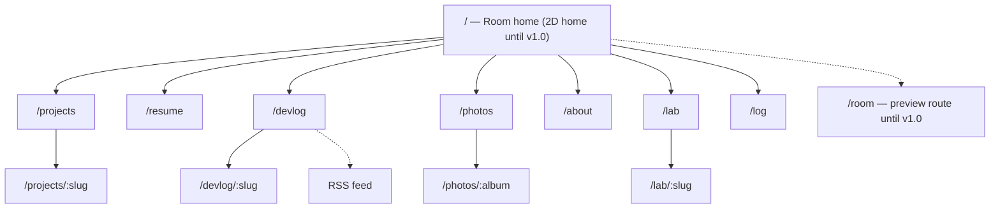
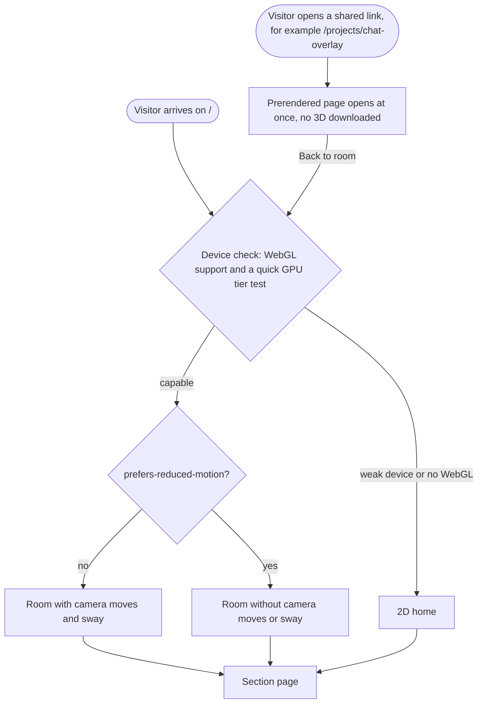

# Sitemap and visitor flows

**Last revised:** 2026-11-15.

## Sitemap

The site has eight sections, each one level deep, and all are reachable from the 2D navigation on every page. During the vertical slice and v0.1 the room lives at `/room` and `/` is the 2D home. In v1.0, the room moves to `/` and the 2D home becomes its fallback.

The room home is the only page that loads three.js - every other route is prerendered HTML. A `404` page catches all other errors.

## Visitor flow

## Navigation model

1. Every route is prerendered to HTML at build time, so pages load fast and read without JavaScript. The list of paths comes from the content index.
2. The root layout holds the 2D nav and a lazy-loaded (`React.lazy`) room canvas. Visiting `/` loads three.js and the GLB behind a progress indicator, but someone who lands directly on a project page never downloads them.
3. Hovering an interactable highlights it and shows a label. Clicking runs a ~0.8 s GSAP camera move, then calls `navigate('/projects')`.
4. After leaving the room, the canvas stays mounted but hidden and paused (`frameloop="never"`). Camera state stays in Zustand, so "Back to room" is instant.
5. Zustand holds the state the DOM and the scene share: hovered and selected object, camera target, quality tier, light/dark mode, weather.

## Interaction states

1. **Idle:** subtle ambient motion only (steam, the cat's routine, curtains flowing in the wind, etc.), with no cue that pulls attention.
2. **Discoverability:** after 5 seconds with no input, interactables give a gentle one-time pulse.
3. **Hover/focus:** rim highlight, the custom cursor's hover form, and a floating label in HTML rather than in 3D, so it stays crisp and accessible.
4. **Pressed:** a small squash or object animation lasting under 150 ms.
5. **Transition:** a camera move of about 0.8 s, which can be skipped by clicking again or pressing Esc.
6. **Return:** "Back to room" restores the previous camera position.

## Camera and input

- Fixed isometric view, with limited pan and zoom so visitors can't get lost. Full rotation is disabled.
- Camera sway rocks the view 5 degrees with the cursor; it's off for touch and reduced motion.
- Pointer raycasting runs against simplified `COL_` proxy meshes, which are cheaper and easier to hit than detailed geometry.
- Through keyboard controls, users can cycle through interactables through hidden DOM buttons kept in sync with the 3D objects with tab, activate them with enter, and go back with escape.
- Tap once to highlight and show the label, tap again to open. Phones get larger hit proxies.

## Loading experience

The 2D nav and a lightweight illustrated placeholder of the room appear immediately, and the live scene fades in when ready. A loader never blocks content for more than 5 seconds.

## Wireframes

Eight low-fidelity artboards were created in sub-phase 0.3. They live in a private design file rather than this repository - their decisions are recorded here. The final look comes from the [art direction](../art/art-direction.md) document.

| Artboard | What it settles |
| --- | --- |
| Room home (desktop) | 2D nav and skip link above the room; "what's new" panel bottom left; "Switch to the 2D site" bottom right; hover label on an object |
| 2D home | The v0.1 home and the room's fallback: intro, "Enter the room" on capable devices, a card per section (Explore), then "what's new" below it |
| 2D home on a phone | Collapsed menu, theme button, stacked sections, 44 px touch targets |
| Projects list | Intro, tag filters, project cards (chat overlay and this site); Devlog and Lab reuse it |
| Project page | Title, role/tech/year/links, demo media, problem / what was built / how it works / outcome; Devlog posts and Lab demos reuse it |
| Resume | "Download PDF" at the top, experience, education, skills, and a contact box (city or region only); About reuses the text layout |
| Photo album | Album switcher, photo grid with captions, full-screen viewer with arrow keys |
| Reading & Movie Log | Type, status and sort filters; a table that scrolls sideways on phones; notes expand in place |
